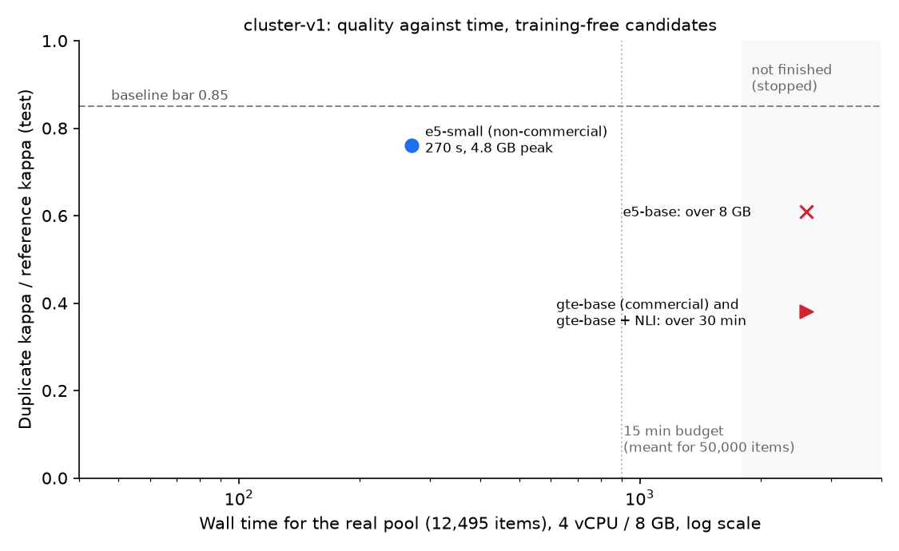

# Benchmark cluster-v1: deduplication and clustering of JTBD items (feature 009)

Status 2026-10-11. All numbers are **agreement with two reference models** (Claude Opus through the
Claude Code CLI and GPT-5.4 mini through OpenRouter pinned to OpenAI) on the frozen benchmark
`cluster-v1`, not accuracy against human judgement. The report quotes no corpus text; the examples
in the guideline are fictional.

## Result in one paragraph

The two reference models agree well enough on what is the same need (duplicate kappa 0.68 on test)
and what belongs together (cluster B-cubed F1 0.66), and moderately on which need is more specific
(kappa 0.49), so all three levels are produced (decision `go` after one guideline revision). No
training-free candidate reaches the baseline bar of 0.85 of the reference-vs-reference value on the
duplicate level: the best, multilingual-e5-small, reaches 0.76; the commercially usable gte reaches
0.38. The main cause is the development split: its consensus holds only 8 duplicate pairs, too few to
tune the duplicate threshold, and every candidate's threshold came out too strict (recall 16-47 %).
Following FR-025, a trained model (or a larger development set) is to be decided in a new feature.
The specificity relation through an NLI model reaches the bar (0.85), but that model cannot be
released: part of its training data states no licence.

## Benchmark

- Pool: 12,495 items from the span runs of the released scout-large over the stored corpora
  (pilot-v1 and span-train-v1), split by snapshot into dev (3,395 items, 45 snapshots), test (6,967,
  83) and holdout (2,133, 22). 288 items from 15 snapshots of sources with a recorded opt-out
  (motor-talk.de, forum.cyclinguk.org; decision D-benchmark-optouts) were left out before freezing.
- Pairs: same kind, stratified by two samplers that are no candidates (LaBSE pooler cosine and
  lexical token-sort ratio): high (top 1 %), middle (1-20 %) and random; dev 400, test 1,200,
  holdout 300.
- Sets: a seed item and its 39 nearest neighbours of any kind; dev 4, test 12, holdout 4.
- Frozen hashes in `topics/productdev/benchmarks/cluster-v1/manifest.json`; texts stay in `data/`.

## Reference agreement and decisions

| Split, guideline | Duplicate kappa | Specificity kappa | Cluster level 1 B-cubed F1 | Contested pairs |
|---|---|---|---|---|
| test, first guideline | 0.45 | 0.39 | 0.48 (3 valid sets) | 172 of 1,200 |
| holdout, revised guideline (re-pilot) | 0.64 (0.44-0.79) | 0.65 (0.44-0.82) | 0.69 (0.60-0.76), 4 sets | 26 of 300 |
| test, revised guideline | 0.68 (0.57-0.77) | 0.49 (0.37-0.59) | 0.66 (0.59-0.74), 11 sets | 96 of 1,200 |
| dev, revised guideline | 0.52 (0.26-0.72) | 0.49 (0.21-0.69) | 0.51, 2 sets | 27 of 400 |

Thresholds (frozen before labeling): duplicate kappa 0.60, specificity kappa 0.40, cluster B-cubed
F1 0.60. 95 % bootstrap intervals in brackets.

- First pilot on test: every level below its threshold, decision `revise`. The disagreements on dev
  showed one reference calling quotes on the same topic or mood the same need, and losing track of
  item ids in 40-item sets.
- Revision (once, as the protocol allows): guideline rules 8-12 with five fictional contrast
  examples (topic is not need, judge the core need of long quotes, compare vague statements
  literally, a related measure is not a special case, a quote that states another plus more is the
  more specific one), the item count in the set prompt, and more reasoning for the GPT reference
  (with a larger output limit after its first holdout sets were cut off; those four sets were
  labelled once more, recorded in the run manifest).
- Re-pilot on holdout: every level at or above its threshold, decision final `go` for duplicates,
  specificity and cluster level 1; level 2 not measured (no reference proposed coarse groups).
- dev and test were then labelled again with the revised guideline, so tuning and scoring use the
  same guideline as the decision. Test confirms the decision on four times as many pairs.
- Contested pairs are scored neutrally (neither hit nor error).

## Candidates (scored once each on test)

| Candidate | Licence line | Duplicate kappa (ratio) | Pair P / R / F1 | Specificity kappa (ratio) | Cluster F1 (ratio) |
|---|---|---|---|---|---|
| gte-multilingual-base | commercial | 0.26 (0.38) | 0.86 / 0.16 / 0.27 | not produced | 0.46 (0.70) |
| gte-multilingual-base + NLI | blocked (see below) | 0.26 (0.38) | 0.86 / 0.16 / 0.27 | 0.42 (0.85) | 0.53 (0.80) |
| multilingual-e5-base | non-commercial | 0.41 (0.61) | 0.79 / 0.29 / 0.42 | not produced | 0.47 (0.71) |
| multilingual-e5-small | non-commercial | 0.51 (0.76) | 0.60 / 0.47 / 0.53 | not produced | 0.29 (0.43) |

Ratio = candidate value divided by the reference-vs-reference value on test. Baseline bar: 0.85 on
each level (`cluster-criteria.yaml`). Tuned on dev only: `t_dup` 0.91 (gte), 0.94 (e5-base), 0.93
(e5-small); level-1 threshold 0.65 (gte), 0.70 (gte + NLI), 0.85 (e5); `t_spec` 0.70 and `t_nli`
0.70 for the NLI variant. Settings: `configs/productdev/jtbd/cluster-*-tuned.yaml`.

Duplicate B-cubed F1 over the items of consensus pairs is 0.985-0.990 for every candidate: most
items are singletons, so B-cubed rewards not merging; the pair statistics show the missed
duplicates.

## Why no candidate meets the bar, and what follows

- **Too few duplicates to tune on.** The dev consensus holds 8 `same` pairs (test 38). The F1 grid
  over `t_dup` is flat over wide ranges; ties go to the stricter threshold by rule, so the tuned
  thresholds merge too little. Scoring on test once per candidate (as the protocol demands) shows it.
- **Encoders differ in where "same" sits.** e5 places paraphrases closer together than gte; with a
  threshold tuned on so few pairs, its recall is higher. gte separates topics better (clusters).
- **What follows (FR-025):** a trained model, or tuning on a development set with more duplicate
  pairs, is to be decided in a new feature. The benchmark, the references and the harness are ready
  for it; no candidate of this feature is released as is.

## Licences

- gte-multilingual-base (native transformers checkpoint `alibaba-nlp-community/gte-multilingual-base`,
  weights byte-identical to `Alibaba-NLP/gte-multilingual-base`; the original's remote code does not
  run on transformers 5): Apache-2.0, commercially usable. Registered as `cairn-base` (in progress).
- multilingual-e5: MIT weights, but fine-tuned on MS MARCO and Quora (non-commercial terms), so
  non-commercial for the zoo.
- NLI model `MoritzLaurer/mDeBERTa-v3-base-xnli-multilingual-nli-2mil7`: trained on XNLI and ANLI
  (CC BY-NC 4.0) and on LingNLI and multilingual-NLI-26lang-2mil7, which state no licence. Not even a
  non-commercial release can rely on it; the specificity relation needs another model.

## Speed and memory

`jtbd cluster perf` on a temporary Railway service in EU West (Amsterdam), limited to 4 vCPU and
8 GB RAM, no GPU (AMD EPYC 9655P host; decision D-railway-perf), models downloaded beforehand and the
Hugging Face hub offline during each run, 30 minutes per run at most:

| Candidate | Real pool (12,495 items) | Scale set (50,000 items, resampled) |
|---|---|---|
| e5-small | 270 s, peak RSS 4.8 GB | stopped (memory) |
| e5-base | stopped (memory, over 8 GB) | over 30 min |
| gte-base (commercial) | over 30 min | over 30 min |
| gte-base + NLI | over 30 min | over 30 min |

No candidate meets the stage budget (SC-005: 50,000 items in at most 15 minutes and 4 GB); already
at 12,495 items the only finished run needs 4.8 GB. The likely cause is the average-linkage step on a
dense candidate graph: with a candidate floor of 0.50 these encoders connect almost every item of a
kind into one component, and the neighbour lists of merged clusters grow towards quadratic size.
Keeping only edges close to `t_dup` (or a different grouping algorithm) is the first thing to try in
the follow-up feature; it changes the candidate, so it has to be tuned and scored again.

## Cash

EUR 4.69 of the EUR 20 budget: EUR 3.94 on the OpenRouter key (GPT reference, all splits including
the relabelling with the revised guideline) and EUR 0.75 for the Railway service (upper bound from
its limits and running time). The Claude reference ran on the subscription.

## Reader check (SC-006)

Done by the owner on 2026-10-11; time and outcome to be recorded.

## Known limits

- Agreement with two frontier models, not human judgement; the references are a mini-tier model
  and a consumer-subscription model (decision D-cluster-v1-references, scoped waivers).
- Short and generic quotes: the guideline compares them literally, which keeps them apart.
- Level 2 clusters are not produced; specificity is not produced by a releasable candidate.
- Tuning and some scoring ran on a laptop GPU (MPS); speed and memory are measured on the CPU
  reference machine only.
